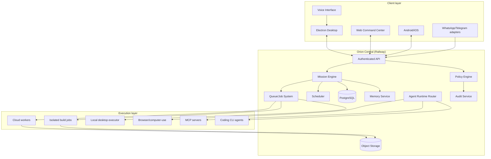

# ORION Target Architecture

Dokumen ini adalah arsitektur target. Sebagian komponen sudah ada di repo (desktop lokal), sebagian baru dispesifikasikan. Lihat `docs/competitive-benchmark.md` untuk status `IMPLEMENTED` vs `MISSING`.

## Prinsip

1. **Orion Core adalah pusat otoritas.** Klien (desktop/web/mobile) tidak mengimplementasikan otorisasi bisnis atau kontrol agent tanpa batas.
2. **Policy engine tunggal** mengatur semua izin: tool, workspace, jaringan, secret, publikasi, biaya, delegasi, approval, emergency stop, audit.
3. **Durability eksplisit**: status DB bukan bukti operasi eksternal; gunakan operation record, receipt, idempotency, reconciliasi.
4. **Cloud task tidak boleh diam-diam mengakses komputer lokal.** Local task tidak boleh dapat diakses remote tanpa otorisasi terautentikasi.
5. **Agent CLI (OpenCode/Claude Code/Codex) adalah backend eksekusi**, bukan sekadar model API.

## Komponen logis

### A. Client layer

- **Electron desktop** (repo ini): UI, secret lokal, bridge IPC, MCP stdio, browser/computer-use lokal.
- **Web command center** (Cloudflare Pages/Workers): dashboard misi, approval, observability.
- **Android/iOS native**: status misi, approval, notifikasi, suara.
- **Voice interface** di dalam Orion: STT/TTS + perintah suara.
- **Chat adapter WhatsApp/Telegram**: perintah/approval ringan, bukan kontrol penuh.

Klien tidak melakukan otorisasi bisnis atau eksekusi agent tanpa batas.

### B. Orion Central

- **Railway** untuk backend API + worker + scheduler.
- **PostgreSQL** untuk state durable.
- **Queue/job system** (pilih berdasarkan kebutuhan: BullMQ/Redis atau Postgres-based queue) untuk eksekusi asinkron.
- **Cloudflare Pages/Workers** untuk frontend web dan edge function yang sesuai.
- **Object storage** (S3-compatible) untuk artefak besar.
- **Auth** (session/JWT + device binding) untuk desktop/web/mobile.

### C. Mission engine

- Mission creation & validation.
- Plan generation (task + dependency).
- Scheduling.
- Checkpoint persistence.
- Budget accounting.
- Approval checkpoint.
- Retry/recovery.
- Cancellation.
- Artifact tracking.
- Completion verification.

### D. Agent runtime

Adapter capability-based:

- Direct model API.
- Coding CLI (OpenCode, Claude Code, Codex) bila terpasang & diotorisasi.
- Hermes Agent sebagai backend opsional.
- MCP tools.
- Browser automation.
- Computer-use agents.
- Local desktop execution.
- Remote cloud workers.

Routing berdasarkan kapabilitas (context window, tool-calling, format output, izin, cancellation).

### E. Governance layer

Satu policy engine untuk:

- Tool permissions.
- Workspace access.
- Network access.
- Secret access.
- Publication/deployment.
- Financial/paid operations.
- Mission budget.
- Agent delegation.
- Human approvals.
- Emergency stop.
- Audit events.

### F. Memory & knowledge

Pisahkan:

- Conversation history.
- Working memory.
- Long-term user/project memory.
- Mission checkpoints.
- Searchable execution history.
- Business knowledge.
- Skills & reusable procedures.
- Evidence & artifacts.

Setiap item memory: provenance, timestamp, scope, deletion behavior.

### G. Execution layer

Lingkungan terpisah:

- Cloud research/dev.
- Isolated coding/build jobs.
- Local workspace tasks.
- Local browser/GUI tasks.
- External integrations.

## Mermaid architecture diagram

## Trust boundaries

1. **Browser/renderer ↔ main process**: IPC terbatas, contextIsolation, sandbox; secret tidak pernah ke renderer.
2. **Desktop ↔ Orion Central**: auth device + TLS; desktop tidak menerima secret cloud penuh.
3. **Cloud worker ↔ local desktop**: cloud tidak mendapat akses filesystem lokal kecuali melalui executor lokal yang diotorisasi.
4. **Agent ↔ tool**: setiap tool invocation dicek policy engine, bukan hanya prompt LLM.
5. **Skill/plugin ↔ core**: skill tidak dapat menaikkan permission sendiri; approval diperlukan untuk skill baru/berubah.

## Status implementasi (ringkas)

- Client desktop: `IMPLEMENTED_AND_VERIFIED` (Windows installer/portable).
- Policy engine lokal: `IMPLEMENTED_AND_VERIFIED` (Node, connector).
- Backend central: `MISSING`.
- Mission engine durable: `MISSING` (lokal partial).
- Agent runtime capability-based: `PARTIAL`.
- Memory service dengan provenance: `PARTIAL`.
- Browser/computer-use: `MISSING`.
- Mobile sync: `MISSING`.

Rincian status per area: `docs/competitive-benchmark.md`.
